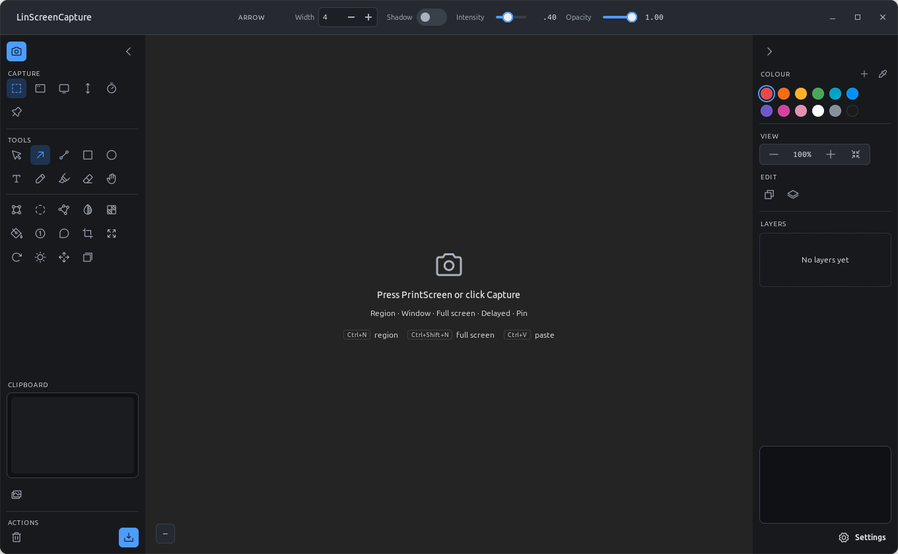
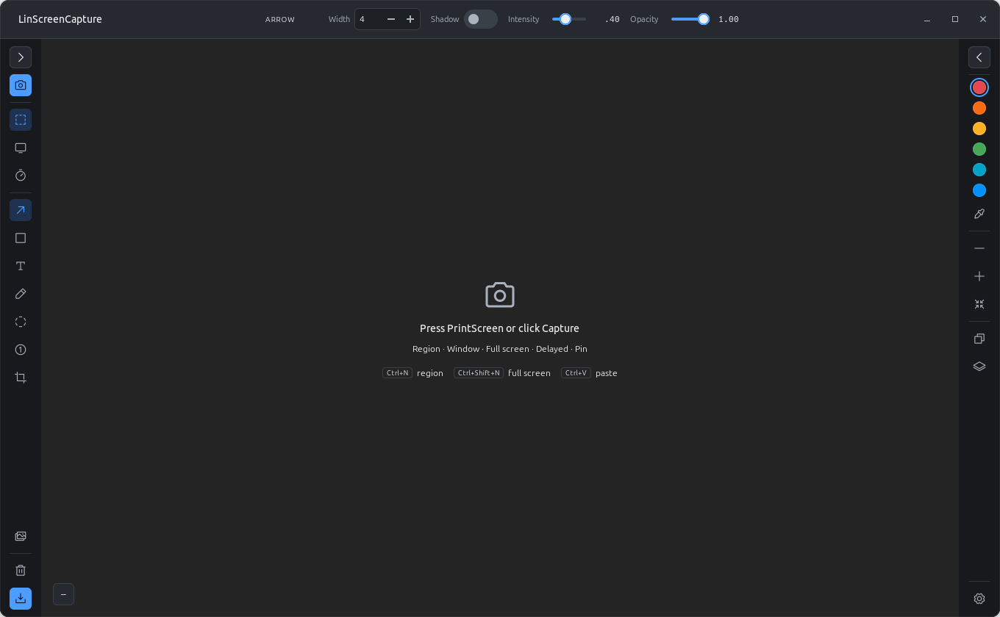
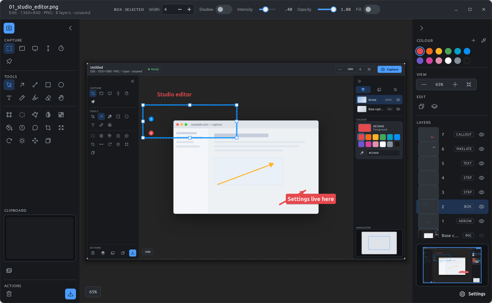
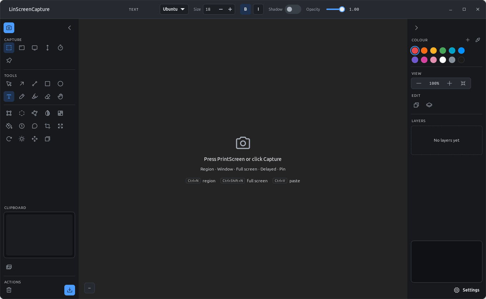
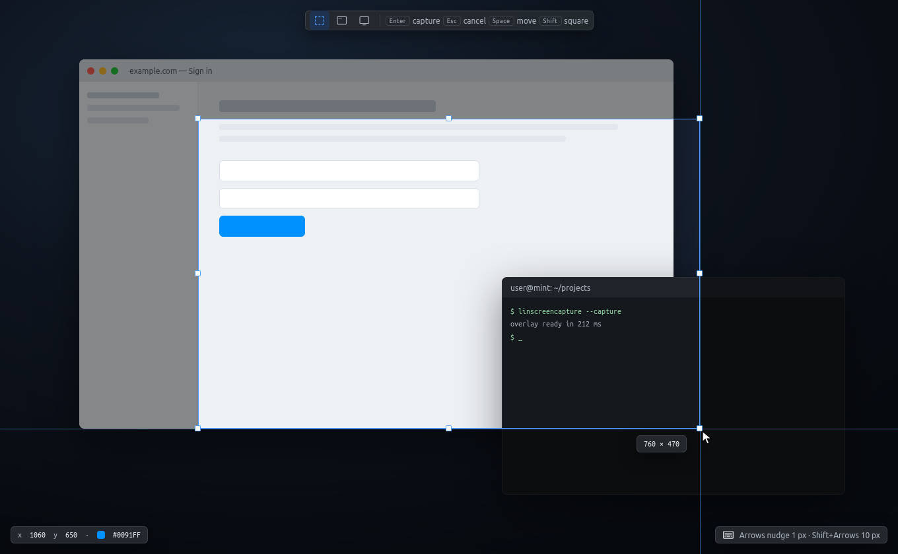
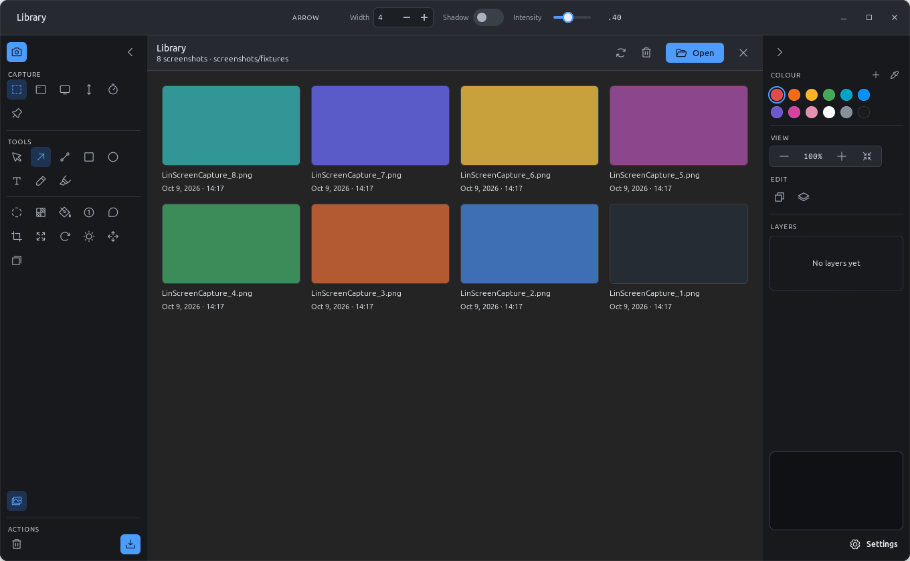
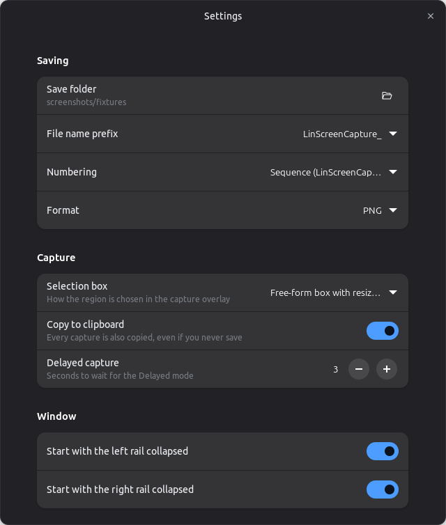

# LinScreenCapture 3

A screenshot studio for Linux, rebuilt from the ground up on **GTK 4 + Python**. Capture a region, window or screen with one key, and land straight in an editor with arrows, boxes, text, step numbers, callouts, blur and crop, all on a dark "Graphite Night" interface with one control size, one glyph size and soft corners.

**Status:** version 3.0, Phases 1–5 of 7 are implemented: the Studio shell, the document/annotation/undo model with settings migration, capture (region, window, full screen on X11; portal and CLI backends for other sessions) with save and clipboard, the annotation editor (every tool as an undoable layer with selection handles and a live Layers panel), and image operations and file flows (crop, resize, rotate, flip, brightness, flatten, save, paste, Library delete, eyedropper). Two review rounds after Phase 5 added soft shadows, per-tool opacity, a clipboard tray, Library group operations, select-all, an Eraser tool with transparent-PNG support, mouse panning (Hand tool, Space, middle button) and an Area tool (box, round and point-chain regions for copy, crop and clear). The legacy C sources are gone. Phase 6 (system integration) is in progress: the background agent, tray icon, hotkey capture, Cinnamon hotkey registration, the Region Plus mode and the System settings page are done; countdown, pin and scrolling capture remain. The screenshots below are renders of the running application, regenerated by `make snapshot`; the design artboards the application is built against live in [docs/mockups/](docs/mockups/) and on the design canvas. Version 1.4.0 (C / GTK 3) lives in the [original repository](https://github.com/MensuraMedia/linscreencapture).

| | |
| --- | --- |
| Design canvas | [LinScreenCapture 3 — Studio Redesign Mockups](https://claude.ai/artifact/NTRyK2yrrpnhbW6sUmnBoA) |
| Feature reference | [docs/FEATURES.md](docs/FEATURES.md) — everything implemented so far, by function |
| PrintScreen guide | [docs/PRINTSCREEN.md](docs/PRINTSCREEN.md) — using the hotkey, the panel icon, changing the key, run at startup, troubleshooting |
| Capture reference | [docs/CAPTURE.md](docs/CAPTURE.md) — hotkey, agent, capture modes, overlay, clipboard, save path (authoritative) |
| Technical specification | [docs/GUI_SPEC.md](docs/GUI_SPEC.md) (living copy: [Claude Doc](https://claude.ai/code/artifact/5e6387bf-76b0-45f6-9874-a6ba13f90732)) |
| Artboard sources | [docs/mockups/](docs/mockups/) (`*.dc.html`, plus the generator for the feature boards) |
| Stack | Python 3.12 · GTK 4.14 · libadwaita 1.5 · Cairo · Pillow · python-xlib · XDG portal |
| Licence | CC BY-NC 4.0 |

## The Studio Editor

**The screenshots in this section are renders of the running application**, regenerated by `make snapshot` into `screenshots/dev/` (2026-10-09, after Phase 4).

### First run


The studio opens with both rails collapsed and an empty stage: **Capture** is the accent button at the top of the left rail, and the stage lists the ways to start — Ctrl+N for a region, Ctrl+Shift+N for the full screen, or the Capture button. The 52 px Graphite header is the window's title bar; here it carries the Arrow tool's property strip (width, shadow, intensity).

### Rails open and collapsed





Rails are 220 px open, 56 px collapsed — collapsed by default on first run, automatically below a 1100 px window, or by hand with Ctrl+[ / Ctrl+] and the carets. Open, the left rail groups **Capture** (six modes), the twelve **Tools** and **Actions** at the bottom; the right rail holds **Colour** (twelve swatches with an accent ring, custom colour behind **+**), the **View** zoom pill, **Edit** (Copy), the live **Layers** list, the **Navigator** and **Settings**.

### Annotating a capture



Every capture lands on the stage as a document, and every annotation is an undoable layer: here an arrow, a selected box (dashed outline, eight handles — the header strip reads "BOX · SELECTED"), self-renumbering step numbers, text, a callout and a pixelate redaction block. The Layers list follows the selection — a row click selects, the eye toggles visibility undoably — the palette recolours the selection, and the navigator tracks the viewport.

### Tool properties in the header



There is no Props panel: the active tool's settings (per-tool width, shadow, intensity and fill; text family, size and weight; step size; blur block) live in the contextual header strip and persist per tool. With a layer selected, the strip shows that layer's settings instead.

### The capture overlay (design artboard)



Region, Region Plus, window and full-screen capture through the frozen-screen overlay are implemented and verified on X11, but a real overlay screenshot necessarily contains the live desktop, so none is committed — run the app and press Capture to see it. The screen freezes behind a 45 % veil with a crosshair, a size chip and a Region · Region Plus · Window · Full screen mode bar. **Region** captures the moment you release the mouse; **Region Plus** keeps eight handles and arrow nudging, and Enter or a double-click captures. Space moves the box while drawing, Shift makes it square, Esc cancels. Details: [docs/CAPTURE.md](docs/CAPTURE.md) §8. The artboard above and the full set in [docs/mockups/](docs/mockups/) stay the design contract for the phases ahead.

### Library



The Library (Ctrl+L) is a full-stage page of the save folder, newest first. Click, Ctrl+click or Ctrl+A select several files; Copy, Duplicate and Delete (trash) act on the selection and only on the library; double-click or Open loads a file into the editor.

### Settings



The Settings dialog (Ctrl+,) has two pages. **Capture**: save folder, file-name prefix, numbering, format, delayed-capture seconds and the window switches. **System**: *Run at startup* (on by default), the background agent (keep running, tray icon, the hotkey opens the editor) and the capture hotkey (PrintScreen by default, a preset or any recorded key combination; register with the desktop). The render above predates the System page.

### Design mockups

The nine design artboards (`screenshots/01`–`09`) remain in the repository as the design contract — control sizes, swatch grid, sidebar grouping, overlay — generated from [docs/mockups/](docs/mockups/) (see "Regenerating the mockup renders" below) and mirrored on the [design canvas](https://claude.ai/artifact/NTRyK2yrrpnhbW6sUmnBoA).

## Features

**Capture**

- Region, Region Plus, window and full-screen capture; a Delayed toggle waits `delay_seconds` before any in-app capture. Scrolling capture, pin to screen and the countdown chip are Phase 6 work.
- **Region** captures the moment you release the mouse; **Region Plus** keeps eight resize handles and arrow nudging, and Enter or a double-click captures.
- Every capture, from any route, goes to the clipboard **first** (lossless PNG, handed to the desktop's clipboard manager), then to the save folder, then into the studio and its clipboard tray. Esc leaves nothing behind.
- Backends: libX11 `XGetImage` first on X11 (about 50 ms), the XDG desktop portal first on Wayland, `gnome-screenshot` / `grim` / `import` / `spectacle` as a last resort.
- One resident instance; the capture hotkey and `linscreencapture --capture` reach it over D-Bus (`app.hotkey-capture`); the overlay is up about 80 ms after the key.
- Full description: [docs/CAPTURE.md](docs/CAPTURE.md).

**Background agent**

- The application runs as a small background agent: closing the studio only hides it, and the agent keeps running with no window until you choose **Quit** (Ctrl+Q or the tray menu).
- The capture hotkey (PrintScreen by default; `linscreencapture --capture`) works everywhere, including inside the studio, and always runs the fast Region capture. The capture is copied to the clipboard, saved and loaded into the studio without popping it up: a hidden studio stays hidden, a visible one is shown again holding the capture. Settings → System → *PrintScreen opens the editor* presents the studio after every hotkey capture.
- On Cinnamon, Settings → System → *Register with the desktop* writes the hotkey as a custom shortcut, frees the key from Cinnamon's built-in screenshot bindings and re-applies it at every agent start. Other desktops need a manual binding.
- An orange (#ffa222) panel icon is shown whenever the app runs (XApp on Cinnamon, MATE and Xfce; Ayatana AppIndicator elsewhere). **Double-click** opens the editor; right-click offers *Capture region to clipboard*, *Open editor* and *Quit*.
- `linscreencapture --background` starts the agent without a window. Settings → System → *Run at startup* (on by default; the first start creates it) writes `~/.config/autostart/com.mensuramedia.LinScreenCapture.desktop`, which does this at login.
- If a hotkey capture fails while no window is shown, a desktop notification reports the error.

**Annotate**

- Select, Move, Arrow, Line, Box, Circle, Text, Pen, Marker, Step number, Callout, Fill.
- Blur and Pixelate redaction as movable layers; Crop with live dimensions; Resize, Rotate and Flip; Brightness, Contrast, Grayscale and Invert with live preview.
- Layers panel with thumbnails, kind badges, visibility toggles and drag reordering; Flatten merges everything into the base image.
- Undo and Redo, 20 levels deep, across annotations and image operations.
- Shift-drag snaps lines and arrows to 45°; Ctrl-drag constrains boxes and circles; Ctrl+V pastes an image as a new layer that resizes like in an image editor: corner handles keep its proportions (Shift: free, Ctrl: about the centre), edge handles stretch one side, the header shows W / H (with a proportions lock), Scale %, *100 %* and *Fit*, and the arrow keys nudge it.

**Colour**

- Twelve round swatches sitting directly in the rail with an accent ring on the current colour, a custom-colour button and an eyedropper that samples from the stage; the collapsed rail keeps the first six one click away.

**Files**

- Sequential or timestamped names with a configurable prefix (`LinScreenCapture_12.png`, `Screenshot_2026-10-08.png`); PNG, JPEG and WebP.
- Library: a full-stage page of the save folder, newest first, with large thumbnails, names and dates; open, refresh and delete (left-rail Library button or Ctrl+L).
- Settings migrate automatically from LinScreenCapture 1.x (legacy `~/.config/linshot/settings.conf`).

**Interface**

- Graphite Night dark theme shipped as one GTK 4 stylesheet; identical on every desktop.
- Phosphor Icons (regular weight) bundled as symbolic icons in a GResource; 46 glyphs, recoloured by CSS.
- Keyboard-first: single-letter tool keys, Ctrl+[ / Ctrl+] for the rails, Ctrl+0 fit, Ctrl+1 1:1, F1 shortcuts window.
- Toasts instead of dialogs for Copied, Saved and errors; dialogs only for Flatten, Delete and unsaved changes.

## What changed from 1.4

| 1.4 (C / GTK 3) | 2.0 (Python / GTK 4) |
| --- | --- |
| Five tabs: Image, Files, Tools, Settings, About | One Studio window: rails, stage, panels, preferences dialog |
| 16 labelled sidebar buttons, 24 px targets, 10 px hand-drawn Cairo glyphs | 30 px targets, 18 px Phosphor glyphs, grouped with hairlines and labels |
| X11 only (`XGetImage`) | Portal, X11 and CLI backends; works on Wayland |
| Lock file + SIGUSR1 single instance | `Gio.Application` activation over D-Bus |
| Annotations drawn into one list | Layers with thumbnails, visibility, reordering |
| Blur, Border, Resize, Rotate, Bright as modal tools | Blur and Pixelate as layers; Resize, Rotate, Brightness as popovers with live preview |
| — | Step numbers, callouts, marker, fill, pin to screen, delayed capture, navigator, toasts |
| 4,438-line `main_window.c` | Five-layer Python package; the model has no GTK and is unit-tested headless |

## Keyboard shortcuts

| Shortcut | Action |
| --- | --- |
| PrintScreen (system; any key can be set in Settings → System) | Region capture to the clipboard, the save folder and the studio, without popping it up (see *Background agent*) |
| Ctrl+N / Ctrl+Shift+N | Capture in the rail's current mode / Full-screen capture |
| Ctrl+S / Ctrl+Shift+S | Save / Save As |
| Ctrl+C / Ctrl+V | Copy composition or selection / Paste image as a layer |
| Ctrl+Z / Ctrl+Shift+Z | Undo / Redo |
| Ctrl+D · Delete | Duplicate layer · Delete layer or capture file |
| V A L B C T P M | Select, Arrow, Line, Box, Circle, Text, Pen, Marker |
| U X N K | Blur, Pixelate, Step number, Crop |
| Ctrl+scroll · Ctrl+0 · Ctrl+1 | Zoom · Fit · 1:1 |
| Ctrl+[ / Ctrl+] | Toggle left / right rail |
| Ctrl+L | Library page |
| Ctrl+, · F1 | Settings · Shortcuts window |
| Esc | Cancel overlay, crop or text; clear selection |

## Architecture

```
linscreencapture/
  app/        Adw.Application + GActions, EditorController, ViewState
  ui/         StudioWindow, rails, stage, capture overlay, preferences, widgets, style.css
  model/      Document, Annotations, UndoStack, Settings, CapturesIndex   (pure Python)
  services/   CaptureService, Clipboard, FileStore, Autostart, HotkeyRegistrar (Cinnamon), IconLoader
  tray.py     status-icon helper: a separate GTK 3 process (python3 -m linscreencapture.tray)
  backends/   portal, x11, cli
data/         icons (Phosphor, -symbolic), gresource.xml, .desktop
docs/         GUI_SPEC.md, FEATURES.md, CAPTURE.md, PRINTSCREEN.md, mockups/
tests/
```

Each layer imports only the layer below it. The model has no GTK, so annotations, undo and settings run under plain `pytest`; widget tests run under `xvfb-run`. The full specification, including every control's icon file and action name, the CSS tokens and the acceptance criteria per milestone, is in [docs/GUI_SPEC.md](docs/GUI_SPEC.md).

## Development setup

```bash
sudo apt install python3-gi python3-gi-cairo gir1.2-gtk-4.0 gir1.2-adw-1 python3-cairo \
                 python3-pil python3-xlib xdg-desktop-portal xdg-desktop-portal-gtk xclip \
                 libglib2.0-dev-bin fonts-ubuntu
git clone https://github.com/MensuraMedia/linscreencapture3.git
cd linscreencapture3
make resources                 # compiles data/ + style.css into linscreencapture/linscreencapture.gresource
python3 -m linscreencapture    # or: pip install -e .[dev] && linscreencapture
```

Background agent on Linux Mint Cinnamon:

```bash
sudo apt install gir1.2-xapp-1.0          # tray icon (gir1.2-ayatanaappindicator3-0.1 on other desktops)
make launcher                             # menu entry for this checkout
linscreencapture --background             # Settings → System → Run at startup does this at login (default on)
```

Hotkey: on Cinnamon, pick the key in Settings → System → *Capture hotkey* and switch on *Register with the desktop*; the agent writes the custom shortcut and makes Cinnamon reload it. On other desktops bind `linscreencapture --capture` by hand ([INSTALL.md](INSTALL.md)). A dead hotkey is diagnosed in [docs/CAPTURE.md](docs/CAPTURE.md) §4. Set `LSC_NO_TRAY=1` to run the agent without the icon.

Start-up and capture diagnostics: `python3 -m linscreencapture --debug` (or `LSC_DEBUG=1`) prints timestamped lines for toolkit versions, resources, settings, backend order, window build time and every capture step, and routes GTK/GLib messages into the same stream.

`make icons` re-syncs the 51 bundled Phosphor glyphs from a local checkout (`ICON_SRC=~/projects/assets/icons/regular`); the SVGs are committed, so a plain clone builds without it. `make test` runs the suite (under Xvfb when `xvfb-run` is installed, otherwise on the live display) and `make snapshot` renders the shell to `screenshots/dev/` for side-by-side comparison with the mockups.

Shell adjustments made after Phase 1 are documented in `docs/SHELL-ADJUSTMENTS-2026-10-08.md` and `docs/TOOL-PLACEMENT.md` (Capture tops the left rail, tool properties live in the header, zoom and Copy/Flatten in the right rail); `screenshots/dev/` shows the running shell.

Window chrome: the Graphite header is the window's title bar (client-side decoration). The minimise / maximise / close buttons follow the desktop's `gtk-decoration-layout`, dragging the header moves the window and double-click maximises. Both rails collapse automatically below 1100 px window width and reopen above it unless you toggled them by hand (Ctrl+[ / Ctrl+] or the carets); the minimum window is 960×600.

### Regenerating the mockup renders

The feature artboards in `docs/mockups/` are generated from `Main.dc.html` by `docs/mockups/gen_mockups.py` and rendered with headless Firefox:

```bash
firefox --headless --profile /tmp/ffp --no-remote --window-size=1360,840 \
        --screenshot screenshots/01_studio_editor.png file://$PWD/docs/mockups/Main.dc.html
```

## Roadmap

| # | Phase | Done when | Status |
| --- | --- | --- | --- |
| 1 | Layout shell | Window matches the Main and Collapsed artboards; every button has tooltip and action; rails toggle and auto-collapse; tests green | **done** |
| 2 | Model and settings | Headless tests green; 1.x settings migrate | **done** |
| 3 | Capture | Region, window, screen on X11 and Wayland; clipboard and file written before the editor opens | **done** (X11 verified; portal untested; flow revised in Phase 6, see docs/CAPTURE.md) |
| 4 | Annotation tools and layers | Every tool is a layer: drawn, selected, moved, undone | **done** |
| 5 | Image operations and files | Crop, resize, rotate, brightness, flatten, save, paste, library delete; old C sources removed | **done** |
| 6 | System integration | Hotkey registrar (GNOME-safe), autostart, delayed, pin, scrolling capture, preferences | **in progress**: background agent, tray icon, hotkey capture, autostart, the System page, the Cinnamon hotkey registrar, Region Plus and the clipboard fix are done; countdown, pin, scrolling capture and the registrar for other desktops are still to do |
| 7 | Polish and release | Navigator, shortcuts window, toasts, golden-image tests, packaging | |

## Previous version

Screenshots of LinScreenCapture 1.4.0 are kept in [screenshots/v1/](screenshots/v1/). Its C sources were removed from this repository once Phase 5 reached parity; they remain in the [original repository](https://github.com/MensuraMedia/linscreencapture).

## Credits and licence

Icons: [Phosphor Icons](https://phosphoricons.com) (MIT). Fonts: Ubuntu and Ubuntu Mono.

LinScreenCapture is released under Creative Commons Attribution-NonCommercial 4.0 (CC BY-NC 4.0). Free for education, research and personal projects; commercial use requires permission. See [LICENSE.md](LICENSE.md).

Repository: [github.com/MensuraMedia/linscreencapture3](https://github.com/MensuraMedia/linscreencapture3)
